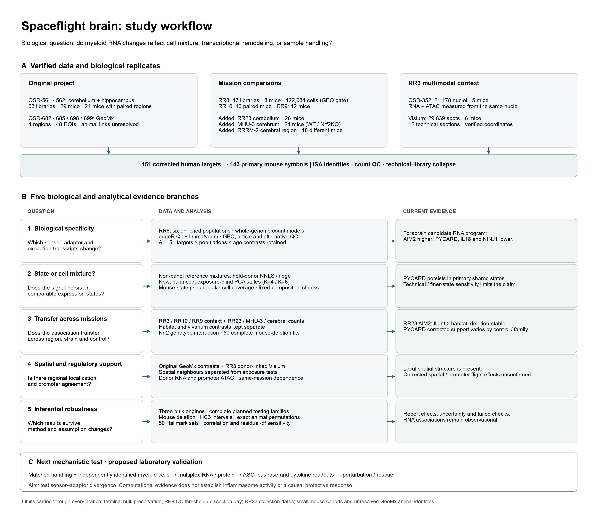
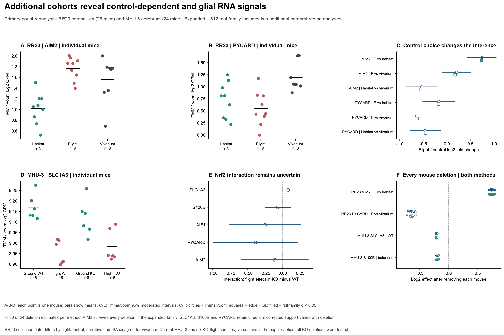
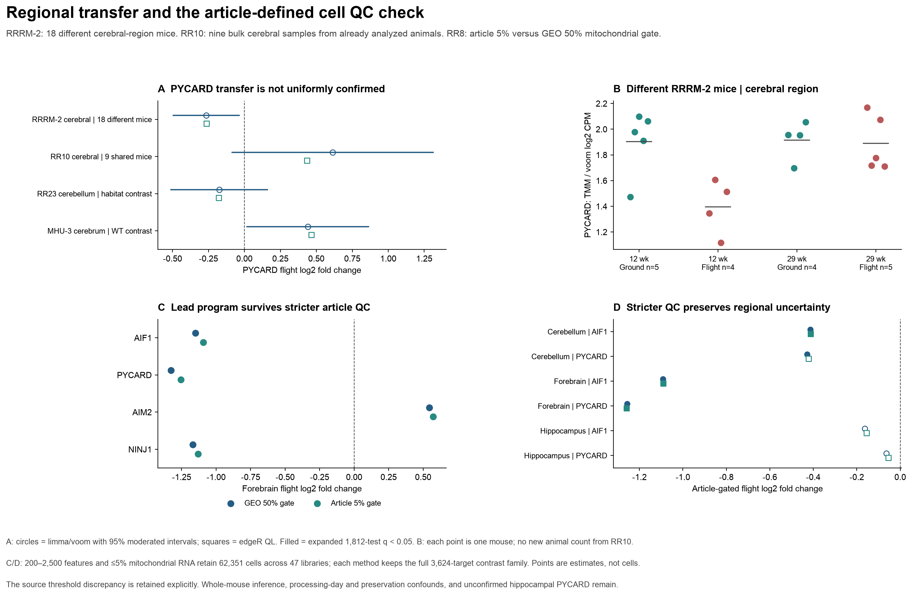
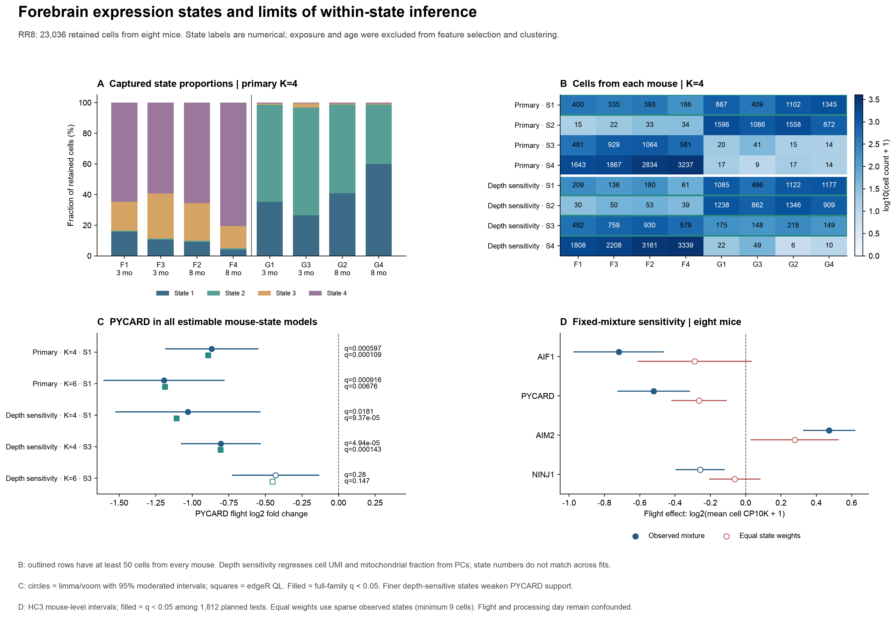
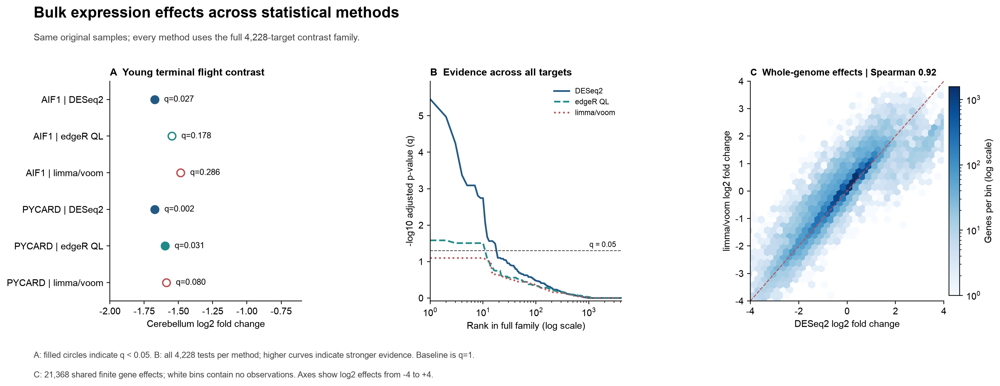
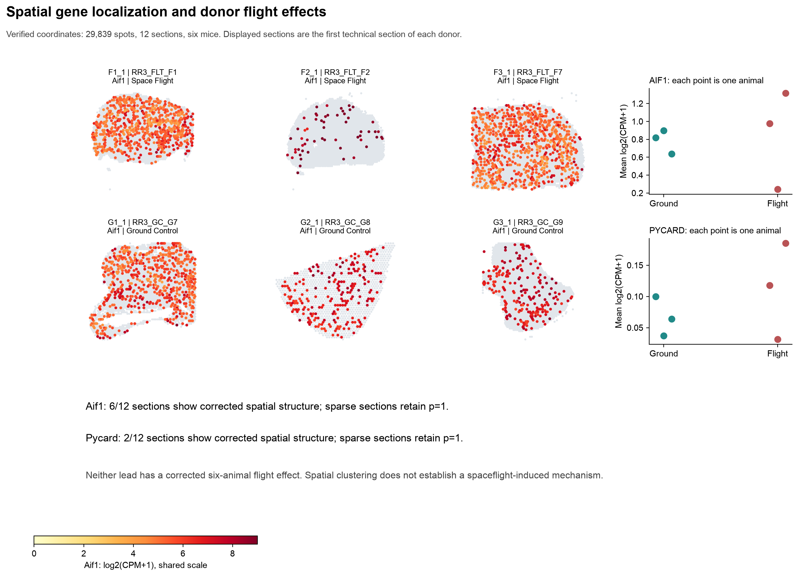
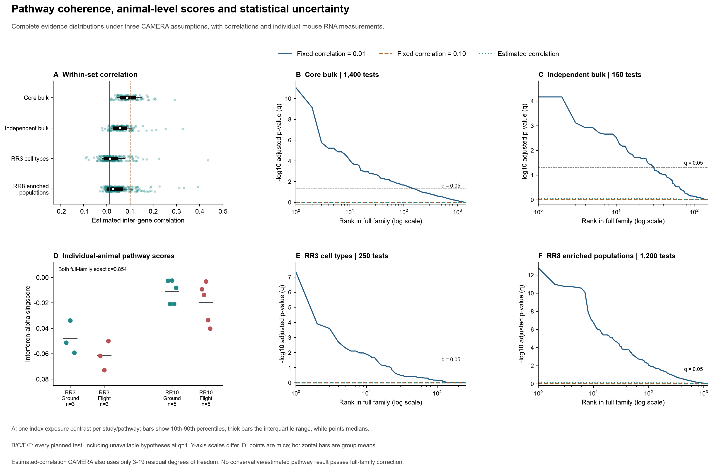

# Context-dependent innate-immune RNA responses in spaceflight mouse brain

**An animal-level reanalysis of a corrected CNS gene panel across NASA OSDR bulk, enriched-cell, RNA/ATAC and spatial datasets.**

[Data and direct downloads](data/README.md) · [Methods](docs/METHODS.md) · [Findings and interpretation](docs/FINDINGS.md) · [All figures and captions](docs/FIGURES.md) · [Reproduce the study](pipeline/README.md) · [Validation](docs/VALIDATION.md) · [References](docs/REFERENCES.md)

## Abstract

Spaceflight brain transcriptomes can reflect changes in captured cell populations, cellular transcription, collection conditions and control selection. We reanalyzed a supplied panel of 151 human analytes, mapped to 143 unique primary mouse symbols, using deposited count matrices and verified animal identities. Whole-genome models precede panel extraction; complete testing families, unavailable estimates and sensitivity failures are retained. Analyses include the original six OSD accessions, independent bulk cohorts, RR8 enriched populations, RR3 RNA/ATAC and Visium, additional control/genotype contrasts, and mouse-deletion refits.

The clearest additional-cohort result is higher cerebellar **AIM2 RNA in RR23 flight versus habitat-ground mice**, corrected in both count engines and every one-mouse-deletion fit. That association is unconfirmed against vivarium controls. In RR8 enriched forebrain, 44 distinct panel genes pass correction across eight method/QC combinations, including an opposing AIM2/PYCARD RNA pattern. These combinations reuse eight mice, and exposure is confounded with processing day. Primary expression-state models support lower PYCARD, while a technical K=6 sensitivity fails correction. Spatial localization is demonstrable, but corrected spatial exposure, conservative pathway and Nrf2-interaction evidence remains unconfirmed.

The contribution is a transparent analysis of **where associations survive and where their interpretation changes**. The results prioritize a sensor/adaptor RNA hypothesis; they do not demonstrate inflammasome activity, EV cargo, protection or a causal mechanism.

## Objective and biological questions

Determine whether CNS target RNA differences associated with spaceflight are consistent with transcriptional remodeling, altered captured-cell mixtures, or sample handling, and assess how well they transfer across tissue regions and control definitions.

1. Which sensor, adaptor and execution transcripts change together or in opposing directions?
2. Do associations persist after RNA-mixture, expression-state and sequencing-depth checks?
3. Does support transfer across cohorts, brain regions, habitat/vivarium controls and Nrf2 genotypes?
4. Do spatial localization and promoter accessibility provide compatible context?
5. Which conclusions survive complete-family correction, alternative engines and animal-level sensitivity tests?

## Study workflow



**Figure 1.** Verified accessions and animal identities feed five question–analysis–evidence branches. The final laboratory validation lane is proposed work. Technical libraries, cells, spots, sections and repeated methods do not increase the number of exposure animals. [PDF](results/extended/figures/figure1_illustrated_study_workflow.pdf) · [Editable SVG](results/extended/figures/figure1_illustrated_study_workflow.svg)

## Data and experimental units

| Branch | Accessions | Verified scope | Main qualification |
|---|---|---|---|
| Original bulk | OSD-561/562 | 53 libraries, 29 mice, 24 mice with paired cerebellum/hippocampus | Terminal preservation differs by exposure group |
| Original GeoMx | OSD-682/685/698/699; GSE239336 | Four regions, 48 ROIs | Animal links unresolved; slide/group confounding |
| RR3 multimodal | OSD-352 | 21,178 nuclei from five RNA/ATAC donors; 29,839 Visium spots in 12 sections from six mice; six bulk mice | Assays and technical sections share biological units |
| RR10/RR9 context | OSD-563/564; OSD-536 | 10 paired-region RR10 mice; 12 RR9 nCounter mice | Different regions, missions and assay coverage |
| RR8 enriched populations | OSD-927–932; GSE295428 | 47 libraries, eight shared mice; 122,084 cells under the GEO gate | Enrichment is not a pure cell type; processing day is confounded |
| Additional bulk | OSD-525/457/613 | 26 RR23, 24 MHU-3 and 18 different RRRM-2 mice | 68 additional different mice; mission independence is not implied |
| Added cerebral region | OSD-612 | Nine measured RR10 mice, already represented elsewhere | Adds a region, not nine independent mice; one ISA sample lacks counts |
| Protein-source context | OSD-738 | 20 submitted ASC records, including four extreme values | Source-scale audit; not pooled with RNA |

The [data page](data/README.md) lists every accession, primary source and direct file download. Assay matrices are downloaded locally and excluded from the current Git tree. The supplied target definition and frozen public metadata/orthology records are included for reproducibility.

## Main findings

| Finding | Quantitative evidence | Interpretation |
|---|---|---|
| RR23 AIM2, flight versus habitat-ground | log2FC +0.741, q=0.0146 (voom); +0.733, q=0.0108 (edgeR); corrected in 26/26 deletions per engine | Stable to individual-mouse influence within this comparator |
| RR23 AIM2, flight versus vivarium | log2FC +0.208/+0.174; q=0.843/0.898 | Control-dependent support; no general flight elevation claim |
| RR8 forebrain panel | 44 distinct genes corrected in all eight engine/QC combinations | Computational robustness in the same eight mice |
| RR8 article 5% QC | AIM2 +0.571; PYCARD −1.256; AIF1 −1.092 (voom) | Opposing RNA directions survive stricter mitochondrial filtering |
| Primary RR8 within-state PYCARD | K=4: −0.867/−0.893; K=6: −1.192/−1.187 (voom/edgeR) | Shared-state support is exploratory; technical K=6 is uncorrected |
| MHU-3 SLC1A3, WT flight | log2FC −0.214; q=0.0172/0.0207 | Glial RNA association; Nrf2 interaction is unconfirmed |
| Original bulk methods | 17/10/0 corrected contrasts among 4,228 tests (DESeq2/edgeR/voom) | Only two DESeq2 discoveries are flight contrasts; method sensitivity matters |
| Spatial and pathway checks | Local Visium structure; zero corrected exact spatial exposure tests; conservative CAMERA results uncorrected | Localization and permissive pathway findings do not establish an exposure mechanism |

Full families and unavailable targets are retained in the [result tables](results/README.md). The extended additional-cohort family has 1,812 tests per engine. RR8 families have 3,624 tests per engine/QC. Focused figures are post-analysis illustrations of those complete families.

### Control selection changes the biological story



**Figure 9.** Each donor point represents one mouse. RR23 habitat, flight and vivarium groups contain 9/9/8 mice. AIM2 is positive and corrected versus habitat-ground in both engines and all deletions, but not versus vivarium. PYCARD versus vivarium does not pass the expanded correction family. MHU-3 includes all 24 deposited mice, six per genotype/exposure group; the genotype interaction does not establish protection. Deletion ranges show influence, not confidence intervals. [PDF](results/deep/figures/figure9_additional_cohort_validation.pdf)

### Stricter cell QC supports a forebrain RNA pattern



**Figure 10.** The separately tested article gate retains 62,351 cells across all 47 libraries, compared with 122,084 under the GEO gate. Lower AIF1/PYCARD and higher AIM2 persist in enriched forebrain. Regional transfer is incomplete; OSD-612 and OSD-613 PYCARD effects do not pass correction. Neither additional cell filtering nor additional regions resolves the RR8 processing-day confound. [PDF](results/deep/figures/figure10_regional_and_QC_validation.pdf)

### State comparisons narrow the interpretation



**Figure 8.** Non-panel PCA/K-means states are learned without age/exposure labels. Donor coverage determines eligibility. Lower PYCARD remains corrected in primary shared K=4/K=6 states, but the eligible technical K=6 model is uncorrected (q=0.280/0.147). Equal-composition tests are sparse or unavailable and do not confirm causal mediation. State learning and testing use the same eight mice. [PDF](results/deep/figures/figure8_expression_state_validation.pdf)

### Effect agreement and q-value distributions replace misleading empty bars



**Figure 2.** DESeq2 and voom effects are highly concordant for the displayed whole-genome contrast (Spearman 0.92), while complete-family discovery counts differ. Agreement in direction is not agreement in uncertainty. Ranked curves display all 4,228 q-values per method; zero voom discoveries remains a verified result. White hexbin space means no observations in that bin. [PDF](results/extended/figures/figure2_method_agreement.pdf)

### Spatial structure and pathway assumptions have separate meanings



**Figure 5.** There are 883 corrected gene-by-section localization tests across 12 sections, not 883 independent genes or flight discoveries. Exact six-mouse exposure tests have zero corrected discoveries. The spatial images describe localization on verified coordinates; they do not establish flight-induced localization. [PDF](results/extended/figures/figure5_Visium_localization.pdf)



**Figure 6.** All 50 Hallmark sets remain in the planned branch-specific families. CAMERA support at fixed correlation 0.01 disappears under fixed 0.10 and estimated-correlation specifications. Estimated CAMERA also changes the residual degrees of freedom. Exact mouse-level pathway scores do not confirm corrected pathway effects. [PDF](results/extended/figures/figure6_pathway_correlation_sensitivity.pdf)

## Contribution and relationship to prior studies

The five contribution axes are **biological question, measurement/contrast, method, statistical evidence, and cellular/mission specificity**. The added contribution is the corrected-panel analysis of opposing RNA directions, control-dependent transfer, all-mouse influence, explicit QC discrepancies, and limits of captured-state/spatial interpretation. The algorithms and multimodal assays are established methods.

Masarapu et al. already integrated RR3 single-cell, accessibility and spatial data; Grandke et al. analyzed the RR8 study; Roy et al. measured inflammasome-related proteins; Kremsky et al. studied the antioxidant intervention; Suzuki/Uruno et al. studied Nrf2 spaceflight biology. This repository does not claim first-ever transcriptomics, multimodal integration, inflammasome change or Nrf2 brain analysis. See the [five-axis comparison](docs/CONTRIBUTION.md) and [primary references](docs/REFERENCES.md).

## Reproduce from a fresh checkout

Install the pinned Python/R environment as described in [pipeline/README.md](pipeline/README.md), then run:

```sh
python run_pipeline.py download-inputs --destination pipeline_inputs
python run_pipeline.py check --inputs pipeline_inputs
python run_pipeline.py run --inputs pipeline_inputs --output pipeline_results --threads 4
```

The single entry point runs **62 ordered stages**, fits deposited counts, builds figures and performs independent checks. Downloads use primary source URLs, expected lengths and SHA256 hashes. ZIP members also receive CRC32 checks. Once inputs are acquired, the default full analysis runs without network access. Inputs total approximately 1.69 GB; this is deposited-matrix analysis rather than raw FASTQ alignment. Use at least 16 GB RAM and several GB of free space.

Recorded validation includes **931 independent numerical checks, 303 input checks, 19 PDF checks and agreement of 18 complete tables totaling 258,677 rows** with the earlier analysis. Full execution was tested on macOS arm64; cross-platform exact equality has not been tested. [Validation details](docs/VALIDATION.md)

## Repository structure

```text
run_pipeline.py                 Single analysis/acquisition entry point
pipeline/                       Ordered Python/R stages, environment and tests
data/                           Data page, direct URLs, hashes, study definitions
  reference/                    Frozen public metadata and panel/orthology records
docs/                           Paper-style methods, findings, captions and comparison
results/                        Derived outputs only
  core/{tables,figures}/        Original bulk/GeoMx and foundational audits
  extended/{tables,figures}/    Integrated figures 1–7 and earlier validation
  deep/{tables,figures}/        Additional cohorts, states, QC; figures 8–10
  deep/technical_state_tables/ Technical-PC sensitivity results
  verification/                Executed checks and environment records
  publication_manifest.json    Hashes of published result artifacts
pipeline_inputs/                Downloaded locally; ignored by Git
pipeline_results/               Regenerated locally; ignored by Git
```

## Interpretation and next experiment

The supported working hypothesis is **context-dependent divergence between innate-immune sensor and adaptor/execution RNA**, with altered mixtures and sample handling remaining alternatives. A matched-handling study in independently identified myeloid cells should measure multiplex RNA, ASC assembly, caspase/cytokine activity and membrane rupture before perturbation/rescue experiments. These tests are proposed, not completed.

Zeros, unavailable effects, regional failures and unsuccessful sensitivity tests are retained. Nominal 95% intervals are distinct from complete-family q-values. RNA abundance is not protein activation or EV cargo. [Limitations and validation plan](docs/LIMITATIONS.md)

Repository maintained by [Isarar Siddique](https://github.com/isararsiddique). Cite this repository together with the original data publications; [CITATION.cff](CITATION.cff) records the repository citation.

This active tree supersedes the older paper packages; their commits remain available in Git history. [History and scope](docs/HISTORY.md)
