# Publication figures and source captions

[Study overview](../README.md) · [Methods](METHODS.md) · [Complete results](../results/README.md)

Main figures 1–10 describe the integrated study. S1–S3 retain complete panels and candidate context. The eight additional core figures provide the original arm's complete panel, design, regional and density views. There are 21 PNG previews, 19 PDFs and 13 editable SVGs. Shared samples across plots are repeated views, not independent evidence.

Black headings, neutral caption text and embedded Arial fonts are used in the recorded PDFs. Portable regeneration falls back to Liberation Sans or DejaVu Sans if Arial is unavailable. PNGs are previews; use the linked PDF/SVG at the intended journal size. Nominal intervals, influence ranges and family-specific q-values have different meanings.

## Figure 1 · Verified study workflow

[PDF](../results/extended/figures/figure1_illustrated_study_workflow.pdf) · [SVG](../results/extended/figures/figure1_illustrated_study_workflow.svg) · [Source ledger](../results/deep/tables/workflow_source_ledger.json)

**Spaceflight brain study workflow.** A, corrected 151-target panel and verified experimental units across original and added datasets. Original bulk comprises 53 libraries/29 mice with 24 paired-region mice; original GeoMx comprises 48 ROIs with unresolved animal identities. Added bulk cohorts contain 26 RR23, 24 MHU-3 and 18 different RRRM-2 mice. OSD-612 adds cerebral measurements from existing RR10 mice. RR3 includes 21,178 RNA/ATAC nuclei from five donors and 29,839 Visium spots from six mice. RR8 has eight shared mice and 122,084 cells under the primary GEO gate; article 5% QC is separately tested. B, five biological/analytical branches connect each question to methods and the current strength of evidence, retaining state, control, regional and assumption failures. C, functional RNA/protein/activity and perturbation tests are proposed. The diagram is drawn from vector boxes/arrows; it has no external illustration dependency. Cells, technical libraries, spots, sections and methods sharing animals do not add exposure replicates.

## Figure 2 · Bulk method agreement

[PNG](../results/extended/figures/figure2_method_agreement.png) · [editable SVG](../results/extended/figures/figure2_method_agreement.svg) · [PDF](../results/extended/figures/figure2_method_agreement.pdf)

Young terminal cerebellar AIF1/PYCARD point estimates from DESeq2, edgeR QL and limma/voom. Filled circles indicate corrected q<0.05; open circles indicate uncorrected results. Panel B plots all 4,228 adjusted p-values per method against their ordered rank on a logarithmic axis; height is -log10(q), and the dashed threshold remains q=0.05. Each method is ranked separately, so points at the same rank need not represent the same gene. The 644 unavailable hypotheses retain q=1. Corrected counts remain 17/10/0 in the full tables, including planned age/cohort/flight contrasts. These are not all flight results. Whole-genome hexbin shows paired finite gene effects, with a logarithmic density scale; white bins contain no observations. Axes display log2 effects from -4 to +4. Density, rank curves and multiple methods reuse the same samples and do not provide independent replication.

## Figure 3 · RNA mixture and confounding

[PNG](../results/extended/figures/figure3_composition_and_identifiability.png) · [editable SVG](../results/extended/figures/figure3_composition_and_identifiability.svg) · [PDF](../results/extended/figures/figure3_composition_and_identifiability.pdf)

Held-out ground-reference NNLS benchmark using 500 synthetic mixtures; known versus estimated immune RNA fraction. Individual young terminal cerebellum samples show estimated RNA fractions (ground n=3, flight n=5), with group means. Conditional log2(CPM+1) OLS effects and 95% model intervals are compared to unadjusted CPM point estimates. These coefficients differ from DESeq2 log2 FC. Estimated fractions are not absolute cell counts; strong collinearity and regional reference transfer prevent mediation claims.

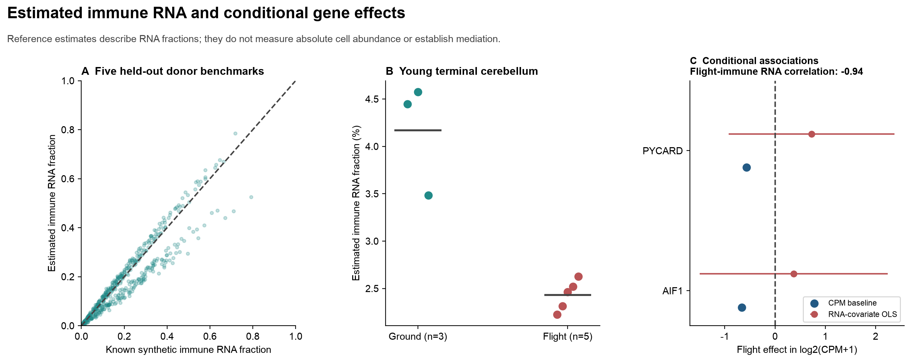

## Figure 4 · Cell-population support and regulatory context

[PNG](../results/extended/figures/figure4_RNA_ATAC_context.png) · [editable SVG](../results/extended/figures/figure4_RNA_ATAC_context.svg) · [PDF](../results/extended/figures/figure4_RNA_ATAC_context.pdf)

Top: RR3 donor RNA and promoter ATAC log2(CPM+1) effects in three eligible broad types; 3 flight/2 ground donors, complete 453-test ATAC family, mm10 TSS +/-2 kb overlap. Bottom: separate RR8 age-balanced myeloid-enriched donor RNA effects, two engines and three QC versions. Circles/squares/triangles identify main/alternative/marker QC; colors identify voom/edgeR; filled points indicate q<0.05 in the complete 3,624-test family per method/QC. Effects are point estimates without confidence intervals. Seven cerebellar and eight forebrain/hippocampal donors; same RR8 mice across regions. Day, mixture and attachment-cleaning limitations persist.

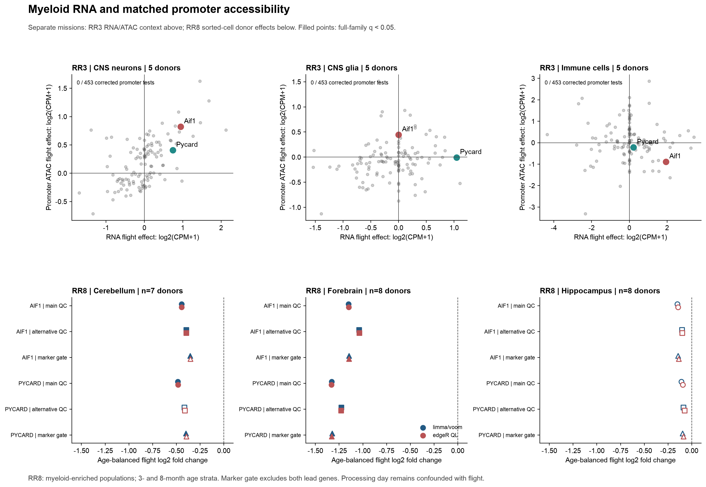

## Figure 5 · Verified Visium localization

[PNG](../results/extended/figures/figure5_Visium_localization.png) · [editable SVG](../results/extended/figures/figure5_Visium_localization.svg) · [PDF](../results/extended/figures/figure5_Visium_localization.pdf)

One predetermined first technical section per donor is displayed, using verified raw full-resolution pixel coordinates and a common 0–9 log2(CPM+1) Aif1 color scale; grey is zero raw expression. No histological region or physical-distance unit is invented. Donor points average both sections; six animals, three per group. Within-section Moran spatial structure uses 499 permutations and all 151×12 tests; separate six-animal exposure tests retain all 151 targets. Sparse sections retain p=1; corrected localization is not a corrected flight effect.

## Figure 6 · Pathway coherence and uncertainty

[PNG](../results/extended/figures/figure6_pathway_correlation_sensitivity.png) · [editable SVG](../results/extended/figures/figure6_pathway_correlation_sensitivity.svg) · [PDF](../results/extended/figures/figure6_pathway_correlation_sensitivity.pdf)

A: one reported estimated correlation per study/population and Hallmark set for the index exposure contrast: young terminal flight for core bulk, age-balanced flight for RR8, flight versus ground elsewhere. Sets require at least ten covered genes for this descriptive display. Thin bars span the 10th-90th percentiles; thick bars show the interquartile range and white points the median. Overlapping gene sets are not independent replicates. Vertical reference lines mark fixed correlations 0.01 and 0.10. B/C/E/F: all adjusted p-values in the complete 1,400/150/250/1,200-test families, ranked separately under each specification; gene-set identities at the same rank may differ. Y-axis scales differ, and -log10(q)=0 means q=1. Unavailable hypotheses remain in the family with p=1. Default-correlation discovery counts remain 156/30/15/209; no conservative or estimated-correlation result passes correction. Estimated CAMERA also uses only 3-19 residual sample degrees of freedom, so it changes both correlation estimation and the uncertainty rule. D: each point is one animal, with group means; RR3 has 3+3 mice and RR10 cerebellum 5+5. Interferon-alpha singscore flight differences are -0.01334 and -0.00895, with exact p=0.300 and 0.302 and full-family q=0.8535 for both. Absolute scores across missions have different gene backgrounds and are not harmonized measurements. Negative score differences are descriptive, not corrected pathway confirmation.

## Figure 7 · Mouse, reference-transcript and depth validation

[PNG](../results/extended/figures/figure7_mouse_and_depth_validation.png) · [editable SVG](../results/extended/figures/figure7_mouse_and_depth_validation.svg) · [PDF](../results/extended/figures/figure7_mouse_and_depth_validation.pdf)

Four forebrain candidates are displayed after complete-panel analysis. A: full-model log2 fold-change points with ranges from eight leave-one-mouse-out count-model refits; these bars are not confidence intervals. B: log2 target RNA relative to the geometric mean of five non-panel myeloid transcripts, HC3 95% model intervals, complete 1,812-test correction. C: mouse-mean expected detection after analytical 500-UMI rarefaction, effects/HC3 intervals in percentage points, complete 1,359-test correction. B/C filled points indicate corrected q<0.05; intervals are nominal 95%, not multiplicity-adjusted. Same eight donors, with age-balanced comparisons. Biological reference transcripts are not assumed stable housekeeping genes; the checks do not remove processing-day or cell-mixture confounding.

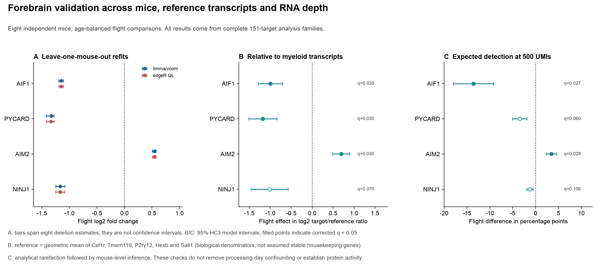

## Figure 8 · Forebrain expression states and limits of within-state inference

[PDF](../results/deep/figures/figure8_expression_state_validation.pdf) · [SVG](../results/deep/figures/figure8_expression_state_validation.svg)

**Forebrain expression states and limits of within-state inference.** A, primary K=4 captured-cell state proportions for all eight mice; non-panel numerical states are assigned without exposure or age labels. B, actual cells per mouse/state under primary and technical-PC K=4 partitions; outlined rows meet ≥50 cells in every mouse. State labels do not match across partitions. C, every eligible balanced-age PYCARD mouse-state model, including the uncorrected technical K=6 sensitivity. Circles indicate voom with nominal 95% moderated intervals; squares indicate edgeR points. Filled markers indicate q<0.05 in 151×K×4-test families per engine/partition. D, observed versus equal-weighted primary K=4 summaries, with HC3 uncertainty and 1,812-test correction. Equal weighting can be sparse (minimum nine cells); absent donor/states are not imputed as zero expression. State learning/testing shares eight mice and exposure/day remains confounded. Technical K=6 failure prevents a universal within-state claim.

## Figure 9 · Additional cohorts reveal control-dependent and glial RNA signals

[PDF](../results/deep/figures/figure9_additional_cohort_validation.pdf) · [SVG](../results/deep/figures/figure9_additional_cohort_validation.svg)

**Additional cohorts reveal control-dependent and glial RNA signals.** A/B, each RR23 point is one mouse; bars are group means of TMM/voom log2CPM. Habitat, flight and vivarium groups have 9/9/8 mice. C, all three RR23 control contrasts for AIM2/PYCARD; voom intervals are nominal 95%, and edgeR points have no displayed interval. D, all 24 MHU-3 mice, six per genotype/exposure group, for SLC1A3. E, genotype-by-flight voom effects (KO flight effect minus WT); no corrected protective interaction. F, every 26- or 24-mouse deletion per engine for the illustrated contrast; ranges are influence estimates, not confidence intervals. Filled markers use the expanded 1,812-test family per engine. AIM2 versus habitat remains corrected in every deletion; other targets have less consistent support. Collection dates, comparator dependence and the published/deposited KO sample-count discrepancy limit interpretation. Every target remains in Figure S3.

## Figure 10 · Regional transfer and article-defined cell QC

[PDF](../results/deep/figures/figure10_regional_and_QC_validation.pdf) · [SVG](../results/deep/figures/figure10_regional_and_QC_validation.svg)

**Regional transfer and article-defined cell QC.** A, PYCARD contrasts across four additional collections; voom nominal 95% intervals and edgeR points, with expanded 1,812-test q thresholds. Regions, strains and collection contexts remain separate. B, Pycard log2CPM in 18 different RRRM-2 cerebral mice: young GC/F=5/4 and old GC/F=4/5, with no identity overlap with the original 29 mice. OSD-612 cerebral counts reuse nine RR10 animals; a tenth ISA animal has no count column. C, leading forebrain voom effects under the GEO 50% and article 5% mitochondrial gates. D, article-gated AIF1/PYCARD effects in three enriched myeloid regions with both count engines and 3,624-test families. Cell filtering preserves forebrain directions but does not resolve processing-day confounding or confirm universal regional transfer. Exact reproduction of author ambient/doublet cleaning is not claimed.

## Figure S1 · All 151 external target rows

[PNG](../results/extended/figures/figureS1_independent_complete_panel.png) · [editable SVG](../results/extended/figures/figureS1_independent_complete_panel.svg) · [PDF](../results/extended/figures/figureS1_independent_complete_panel.pdf)

All corrected labels, including unavailable targets, across three bulk studies (two engines), RR9 nCounter and six RR8 enriched populations (two engines). RR8 uses main QC and balanced-age flight contrast. Assay-specific flight log2 effects are displayed on a common clipped +/-2 visual scale; this does not make their units or sample contexts equivalent. Grey is not estimable. Black dots use each assay/method complete family: 453 bulk, 151 nCounter exact, 3,624 RR8. Tissue columns share mice. No row selection by significance.

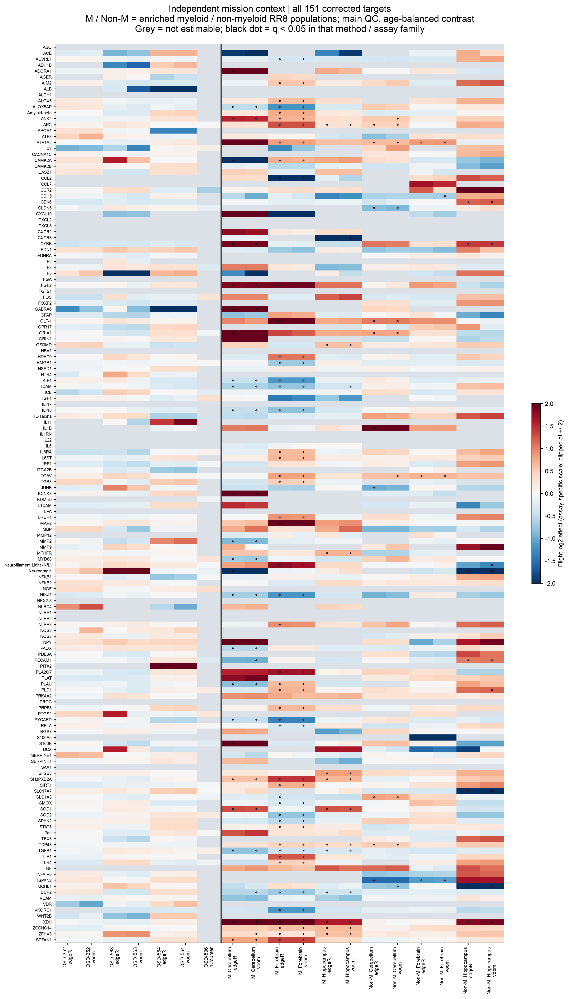

## Figure S2 · Specific biological candidate with donor points

[PNG](../results/extended/figures/figureS2_innate_immune_program.png) · [editable SVG](../results/extended/figures/figureS2_innate_immune_program.svg)

Post-result selection of eleven innate-immune transcripts from the full 151-target analysis; displayed values and significance use full 3,624-test families for every RR8 method/QC. Stars are q<0.05; lack of a star is not evidence of no effect. Donor points use main-QC voom log2 CPM for PYCARD/AIM2/NINJ1: four ground/four flight mice, circles age 3 months, triangles age 8 months; bars are group means. Same-number flight/ground mice are distinct animals. Transcript divergence does not measure ASC assembly, caspase cleavage, cytokine release or membrane rupture. PNG/SVG export only.

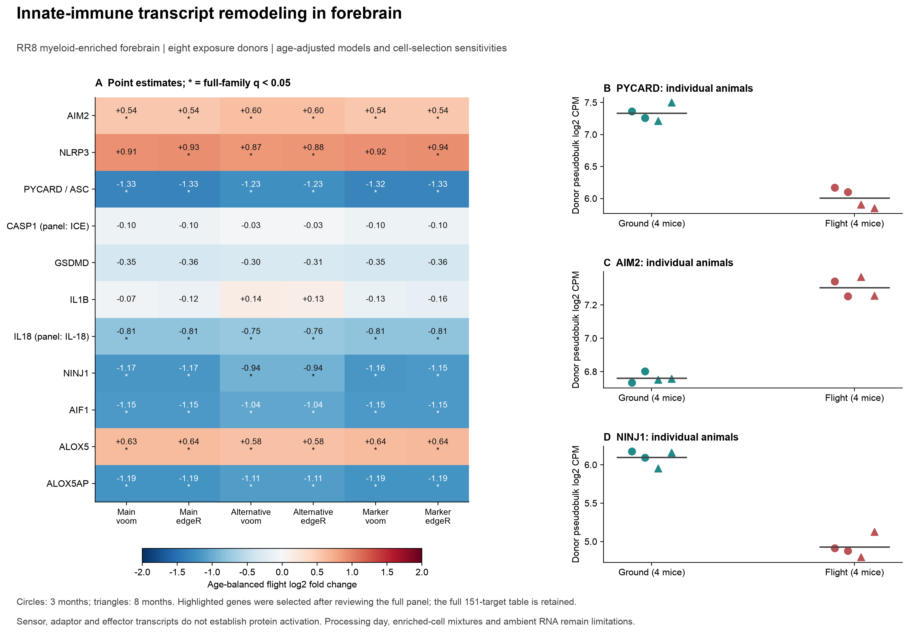

## Figure S3 · Complete additional/regional target panel

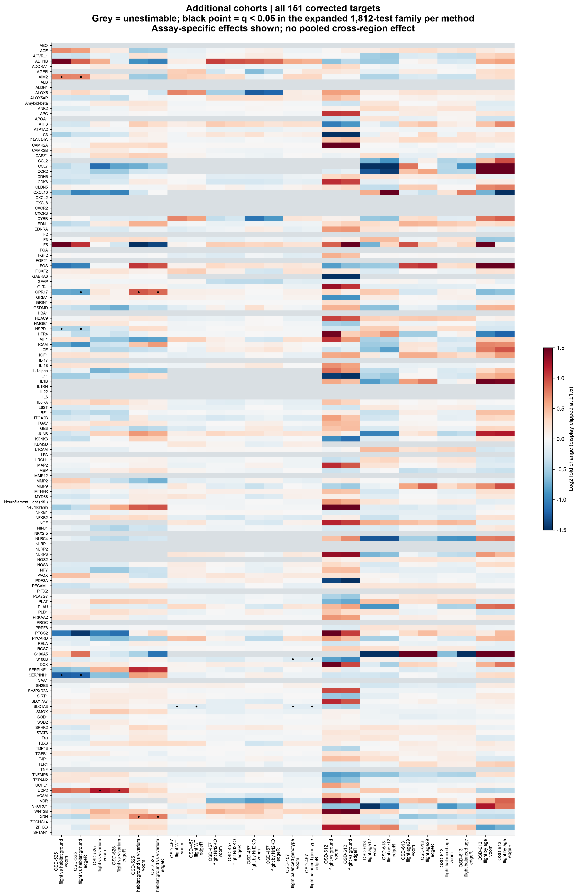

[SVG](../results/deep/figures/figureS3_additional_complete_panel.svg) · [Displayed effects](../results/deep/tables/figureS3_displayed_complete_effects.csv)

All 151 targets, 12 additional contrasts and two engines are displayed in panel order. Color is log2FC clipped at ±1.5 only for display; CSV estimates are unclipped. Grey denotes unavailable estimates, never imputed zero expression; black points indicate q<0.05 in the expanded 1,812-test family per engine. Contrasts and methods sharing mice are not independent discoveries. PNG/SVG only.

## Zero values, missingness and figure provenance

A discovery count of zero means no q<0.05 result under the stated family, not missing data or biological equivalence. −log10(q)=0 means q=1. White hexbin space means no observations in that bin. A zero cell count is real coverage information and can make a state contrast unavailable. Grey panel entries denote an unavailable effect. None of these is replaced with an invented nonzero value.

The numerical figure-value audit and [deep figure ledger](../results/deep/tables/deep_figure_source_ledger.json), displayed-effect CSVs and [workflow ledger](../results/deep/tables/workflow_source_ledger.json) connect illustrations to executed results. The [publication manifest](../results/publication_manifest.json) identifies the published artifact hashes. No additional independent evidence is created by plotting the same data as scatter, density, hexbin, box/point or heatmap views.

## Supporting figures from the original arm

These figures support the original bulk/GeoMx/RR3 analyses. Their numbering is internal to the core branch, separate from integrated main Figures 1–10.

### Core fig01_design_and_QC

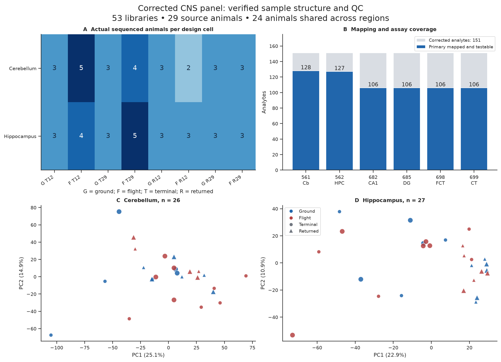

[PDF](../results/core/figures/fig01_design_and_QC.pdf)

Counts are sequenced animals within region. PCA uses centered log2 normalized endogenous expression of the 2,000 highest-variance genes; age 29 uses larger markers. Terminal flight preservation is confounded with exposure.

Sources: bulk_sample_registry.csv;verified_panel_mapping.csv;bulk_panel_complete.csv;spatial_panel_complete.csv

### Core fig02_complete_bulk_panel

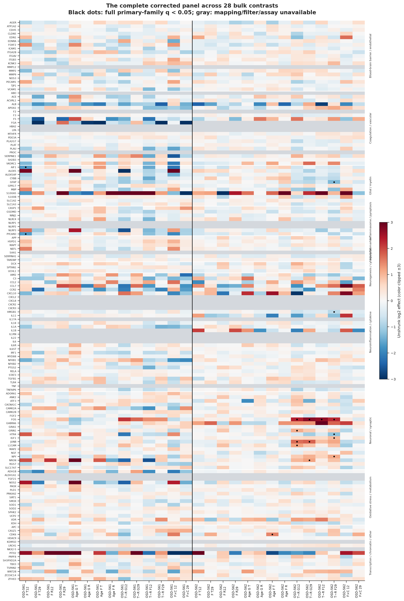

[PDF](../results/core/figures/fig02_complete_bulk_panel.pdf)

All 151 corrected source analytes are retained. Rows use current human symbols; original labels and orthology ambiguity remain in the tables. Color saturation is display clipping, not changed estimates.

Sources: verified_panel_mapping.csv;bulk_panel_complete.csv

### Core fig03_AIF1_PYCARD

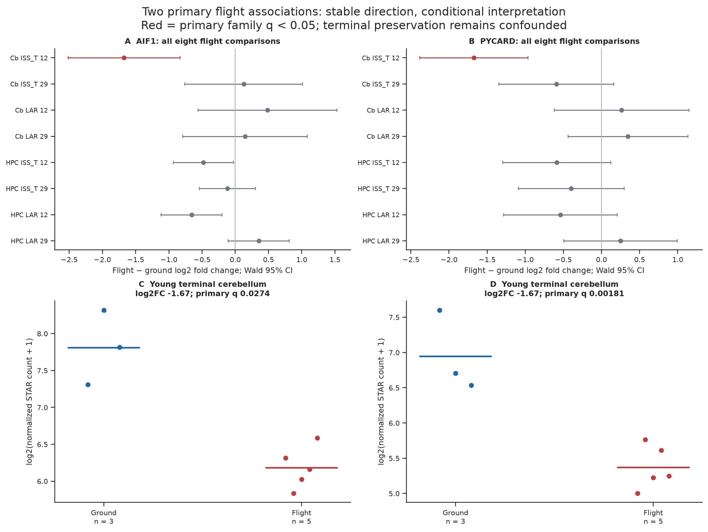

[PDF](../results/core/figures/fig03_AIF1_PYCARD.pdf)

Individual animal points and full-model Wald intervals. These intervals are nominal, not simultaneous. Results do not establish age or region specificity. Rounded RSEM and leave-one-out are shared-sample sensitivities; exact-gene sensitivity has no full-family q<0.05.

Sources: bulk_panel_complete.csv;bulk_count_source_sensitivity.csv;bulk_flight_leave_one_out.csv;bulk_gene_exact_sensitivity.csv

### Core fig04_collection_context_and_pairing

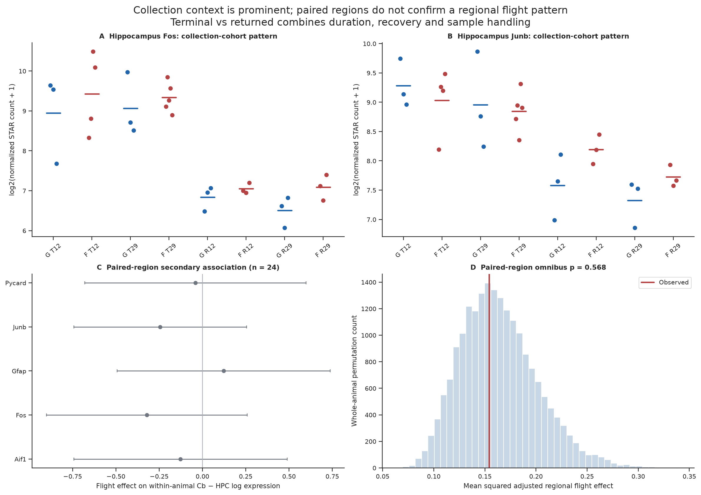

[PDF](../results/core/figures/fig04_collection_context_and_pairing.pdf)

Fos and Junb are measured in the same hippocampal animals. Paired analysis is within RRRM-2, not independent replication; per-gene paired q-values and the 127-gene omnibus are nonsignificant.

Sources: bulk_panel_complete.csv;paired_region_flight_associations.csv;paired_region_omnibus.json;paired_region_omnibus_null.csv

### Core fig05_spatial_factorial_uncertainty

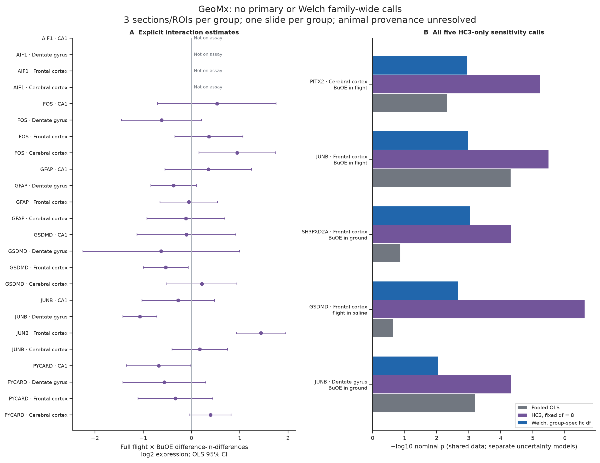

[PDF](../results/core/figures/fig05_spatial_factorial_uncertainty.pdf)

The full interaction is (FLT_BuOE−GC_BuOE)−(FLT_saline−GC_saline). Five fixed-df HC3 calls do not survive the Welch family correction. No model separates slide from group.

Sources: spatial_panel_complete.csv;spatial_sample_registry.csv;spatial_welch_sensitivity.csv

### Core figS01_complete_spatial_panel

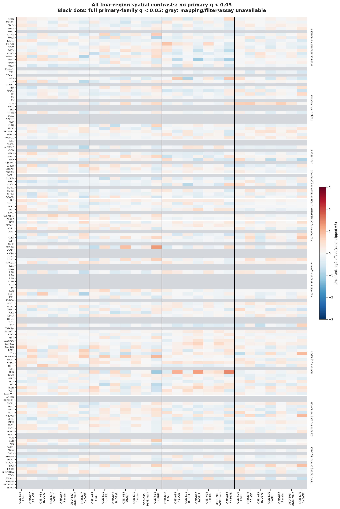

[PDF](../results/core/figures/figS01_complete_spatial_panel.pdf)

All 151 corrected source analytes are retained. Rows use current human symbols; original labels and orthology ambiguity remain in the tables. Color saturation is display clipping, not changed estimates.

Sources: verified_panel_mapping.csv;spatial_panel_complete.csv

### Core fig06_RR3_celltype_context

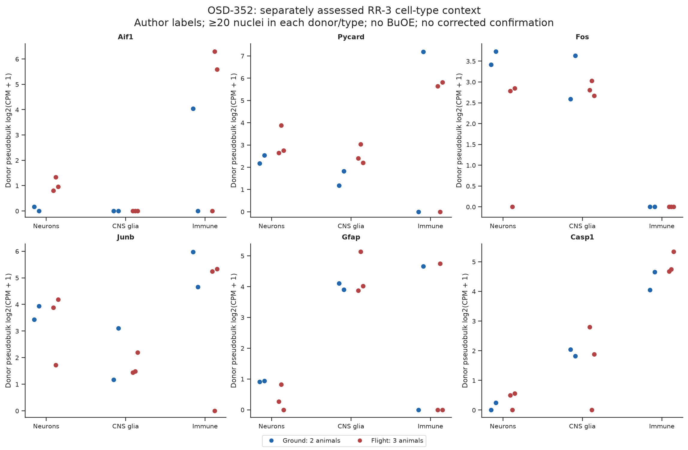

[PDF](../results/core/figures/fig06_RR3_celltype_context.pdf)

21,178 author-annotated nuclei aggregate to five animals. Neurons, CNS glia and immune groups pass the fixed cell-count gate; vascular and neural crest-like groups do not. AIF1/PYCARD effects do not replicate the negative cerebellum direction.

Sources: OSD-352_panel_celltype_context.csv;OSD-352_pseudobulk_registry.csv;OSD-352_panel_celltype_exact_tests.csv

### Core figS02_five_views

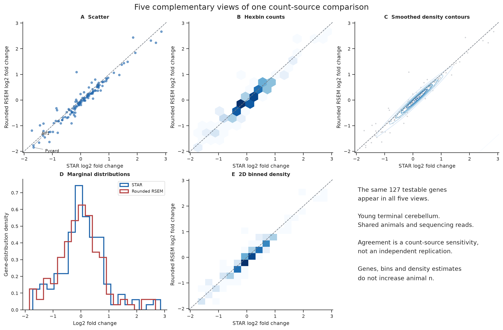

[PDF](../results/core/figures/figS02_five_views.pdf)

Scatter, hexbin, smoothed density contours, marginal distributions and 2D binned density use exactly the same gene estimates. Density is descriptive; shared-sample agreement is not independent validation.

Sources: five_view_source_data.csv;bulk_count_source_sensitivity.csv
