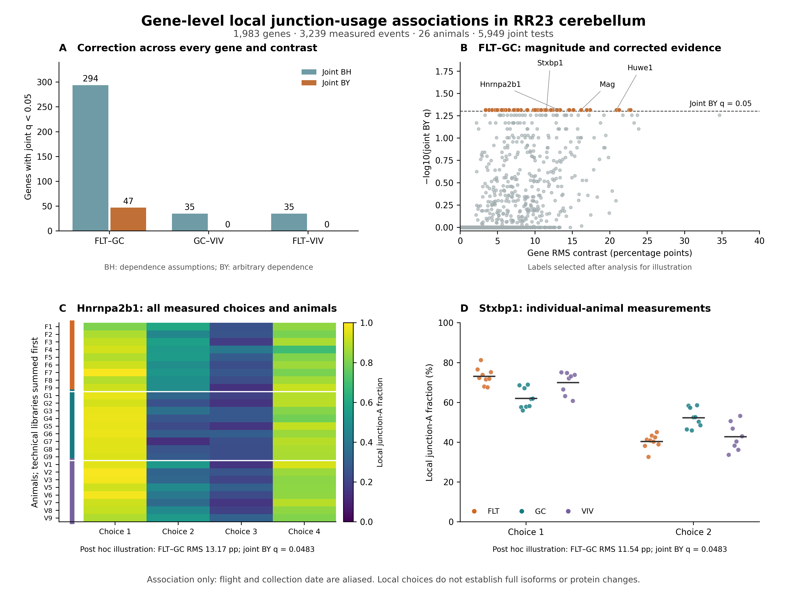

# Gene-level local junction-usage extension

This retrospective analysis adds a gene-level observable phenotype to the repaired RR23 all-animal panel. It identifies **47 FLT–habitat GC gene associations under joint arbitrary-dependence BY correction**, with all 5,949 gene–contrast tests retained. This supports a local RNA-processing association in this cohort. It does not separate flight exposure from collection date, demonstrate a full isoform change, or establish a protein, neuronal injury, or causal flight phenotype.

## Universe and measurement

The input panel was constructed from all 26 animals without group labels. The pre-existing primary measurement gate requires ≥20 unique pair-junction reads in every animal and ≥90% dominance of the two retained junctions among all retained junctions sharing their boundary. Both junctions must map to one common, unambiguous gene using exact GRCm39.112 intron annotation. This yields **3,239 local choices from 1,983 genes**, with 1–12 measured choices per gene (median 1). No event p value, event direction, group-specific contrast, or ontology is used to select genes. Genes excluded by annotation or measurement are outside the observable universe, not negative biological findings.

## Mathematics and inference

For gene g, let E_g be its measured choices and x_ei the unique-read junction-A fraction for choice e in animal i. The statistic for groups A and B is

`T_g = mean_{e in E_g}[(mean_A x_e − mean_B x_e)^2]`.

The reported effect magnitude is `100 × sqrt(T_g)` percentage points. Its magnitude can combine opposing local-choice directions; the complete table therefore also reports the signed mean contrast and an unbiased squared-distance estimate that subtracts within-group sampling variation. The latter may be negative and is not clamped.

Every exact allocation moves an animal's whole event vector. The test therefore preserves correlated choices and shared junctions within each gene, and does not require independent event coordinates. All 48,620 allocations of 18 animals into 9/9 labels, or 24,310 allocations of 17 animals into 9/8 labels, are enumerated. The two-sided, direction-free evidence is the proportion with squared contrast at least as large as observed, including ties. A fixed 1e−14 absolute tolerance in squared-fraction units handles floating-point ties. For the balanced 9/9 contrast the complementary allocation makes the minimum attainable p value 2/48,620.

The computation uses centered Gram kernels and exact allocation outer products; an independent direct group-mean calculation reproduces 12 selected gene p values across the three contrasts, including the most extreme, largest multi-event, middle, and largest-p genes. Manual BH/BY implementations independently reproduce the SciPy-adjusted results. All **31 verification checks passed**.

The primary correction family comprises every one of the **5,949 = 3 × 1,983** gene tests. BH has dependence assumptions; BY controls FDR under arbitrary dependence provided the exact p values are valid under the exchangeability null. Within-contrast corrections are secondary sensitivities and are not substituted for the primary joint correction.

## Results

| Contrast | Joint BH | Joint BY | Within-contrast BH | Within-contrast BY |
|---|---:|---:|---:|---:|
| FLT − habitat GC | 294 | 47 | 431 | 163 |
| Habitat GC − vivarium | 35 | 0 | 0 | 0 |
| FLT − vivarium | 35 | 0 | 6 | 0 |

Every one of the 47 joint-BY FLT–GC genes attains the exact minimum p=2/48,620, with joint BY q=0.048256988. Their gene RMS contrasts range from 3.42 to 22.77 percentage points. The q value is close to the decision boundary and reflects the discrete exact-null resolution; an arbitrary stronger threshold would remove these calls. GC–VIV and FLT–VIV have no joint-BY gene discoveries, which does not establish the absence of control-context or flight-associated differences. In particular, global all-event tests and gene-wise tests ask different questions and have different multiplicity burdens.

The corrected genes are: Ank2, Ccdc82, Csde1, Dap3, Dnm1, Ecpas, Eif2a, Eif4a2, Eif4h, Epb41l3, Eps15, Fubp1, Glrx3, Gpcpd1, Gtf2i, Hnrnpa2b1, Hnrnpc, Huwe1, Kdm1a, Ktn1, Lrch2, Mag, Marchf7, Mia2, Nbr1, Ndrg3, Ndufa5, Olfm1, Opa1, Osgepl1, Pias2, Ptcd3, Rabep1, Rian, Rps6kb1, Sdcbp, Senp7, Stxbp1, Thoc2, Tma7, Tmpo, Tomm6, Trappc8, Trim27, Ube2l3, Ubp1, Xpa.

## Measurement and single-animal sensitivities

The stricter 95% all-animal boundary-dominance gate retains 2,710 choices from 1,724 genes. The original 1,983-gene, 5,949-test family is held fixed; the 259 genes losing all measured choices receive p=1. This sensitivity also yields 47 joint-BY FLT–GC calls, with **45/47 primary genes retaining significance**. Rps6kb1 retains one of its two choices but has q=0.070877; Ecpas loses its sole measured choice and receives p=1. Septin4 and Atosa are sensitivity-only calls. They do not replace or enlarge the primary discovery set. The vivarium contrasts again have no joint-BY gene calls. Counts are 251/23/30 joint-BH genes for FLT–GC, GC–VIV, and FLT–VIV, respectively. This is a fixed-universe measurement sensitivity, not a search for a more favorable filter.

Descriptive leave-one-animal-out effects were calculated for every one of the 1,983 genes under each of the 18 FLT or GC omissions, retaining all 35,694 rows. For the 47 primary-BY genes, the least favorable omission retains at least **85.24%** of the full RMS contrast; the largest ratio is 109.66%. The median per-gene minimum retained RMS is 93.23%. All 18 omissions preserve every measured local-choice direction in 40/47 genes, and preserve the signed mean direction in 42/47. Signed means can cancel opposing lexical local-choice directions and are not a biological direction for the whole gene. No leave-one-out p or q values are computed. Effect stability does not establish independent replication, remove collection-date aliasing, or show that the q values would remain below 0.05 after a smaller-sample test.

Hnrnpa2b1 and Hnrnpc provide RNA-binding follow-up candidates; Thoc2, Fubp1 and Csde1 provide additional RNA-handling candidates. Stxbp1 and Dnm1 provide synaptic trafficking follow-up candidates, and Mag provides a myelin-associated candidate. These are post hoc functional interpretations of gene identities, not tested pathway enrichments, cell-type assignments, or evidence that the associated local choices alter those functions. The biological interpretation requires independent transcript-level confirmation and orthogonal experiments.

## Design limits and next experiments

FLT samples were collected on 14 January 2021, and both habitat GC and vivarium controls on 17 January 2021. Thus exposure and collection date cannot be separately estimated from these animals. Exact label exchangeability is a null assumption, not a correction for this alias. Gene-level significance measures group association under that assumption. Differences between groups could reflect exposure, return handling, sample processing, date, or their combination.

The local choice fractions are read-derived proportions at shared splice boundaries; they do not identify a complete transcript, protein expression, a cell-type-specific phenotype, or neuronal injury. No independent mission replication has been run for this new gene test family. The historical event-level replication uses a different frozen panel and should not be presented as validation of these gene tests.

Useful follow-up would measure the corrected local choices with targeted RT-PCR or long-read RNA in a new cohort whose flight and habitat samples are processed together or randomized across processing batches. The RNA-binding and synaptic trafficking candidates can prioritize assay design without converting annotation into a mechanism.

## Figure

Figure. Gene-level local junction-usage associations in RR23 cerebellum. (A) Gene discoveries at q<0.05 after BH or BY correction across all 5,949 gene–contrast tests. (B) FLT–GC RMS local-fraction contrasts against joint BY q values; names are illustrative post hoc selections. (C) Every measured Hnrnpa2b1 local-choice fraction for all 26 animals, ordered by group. (D) Every animal’s fraction at both measured Stxbp1 local choices; horizontal segments are group means. FLT n=9, habitat GC n=9, VIV n=8. Technical libraries were summed before fraction calculation. Choice coordinates and lexical junction orientation are recorded in figure_source_events.csv. Panels C and D are descriptive illustrations of the gene-level tests, not additional independent discoveries. Gene RMS values average squared contrast magnitudes over all measured local choices assigned uniquely to that gene. FLT and control collection dates are perfectly aliased; the associations therefore cannot identify a flight-only mechanism.

## Reproduction

Run `scripts/analyse_gene_omnibus.py`, `scripts/verify_gene_omnibus.py`, `scripts/sensitivity_dominance95.py`, `scripts/descriptive_leave_one_out.py`, `scripts/verify_sensitivities.py`, and `scripts/build_figure_report.py` with the established project Python environment, in that order. Every script accepts `--base`; the analysis script also accepts `--output`. The default reads only the frozen `paper2_beta_20261014` inputs. `results/manifest.json` records every input SHA-256 hash and the exact allocation family sizes. Complete unsuccessful tests remain in `gene_omnibus_complete.csv.gz`. This is an explicitly retrospective extension constructed after the original all-event results were available, not a preregistered confirmatory analysis.
